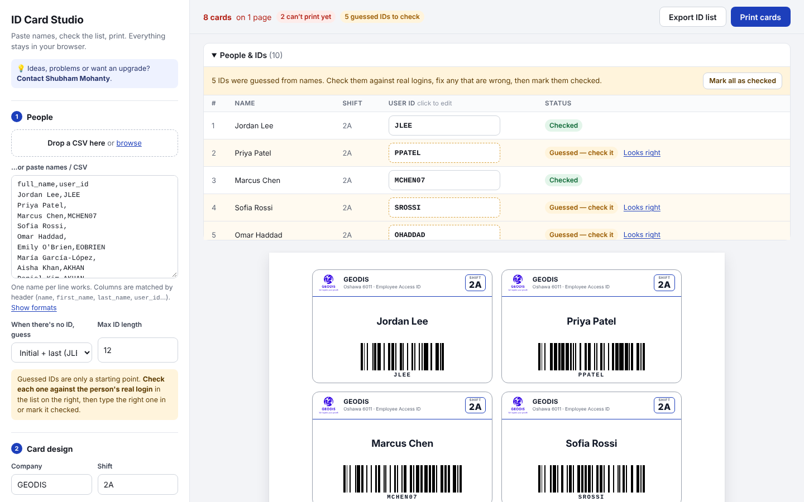
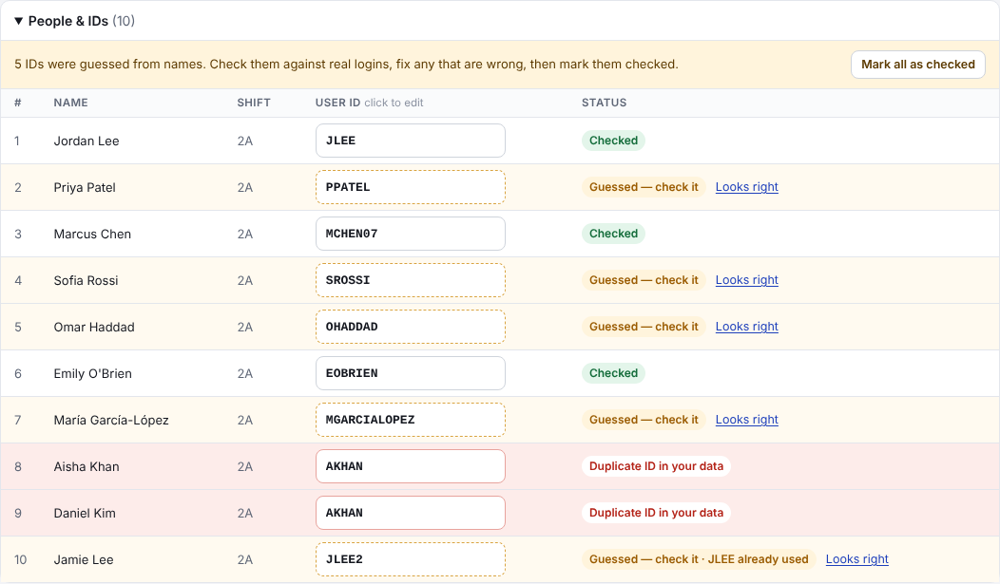
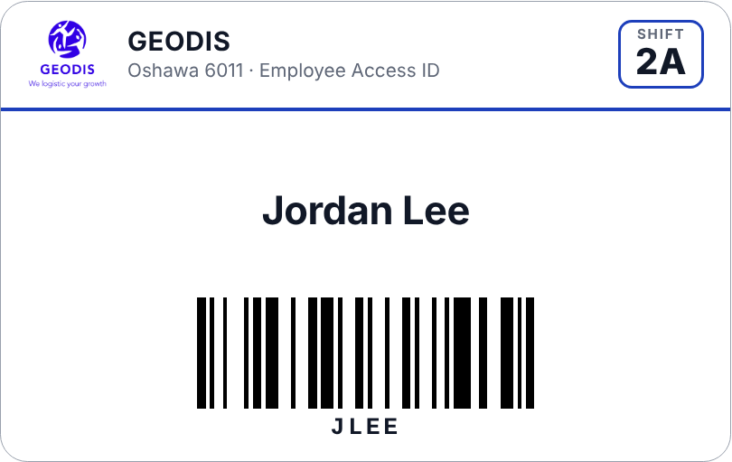
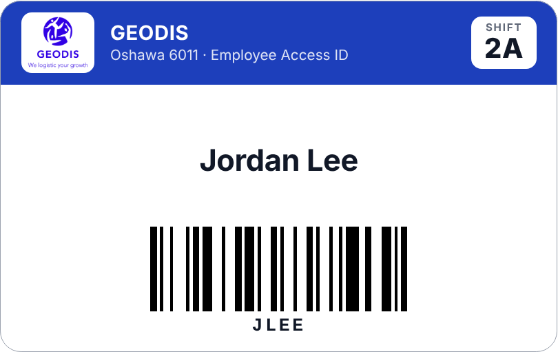
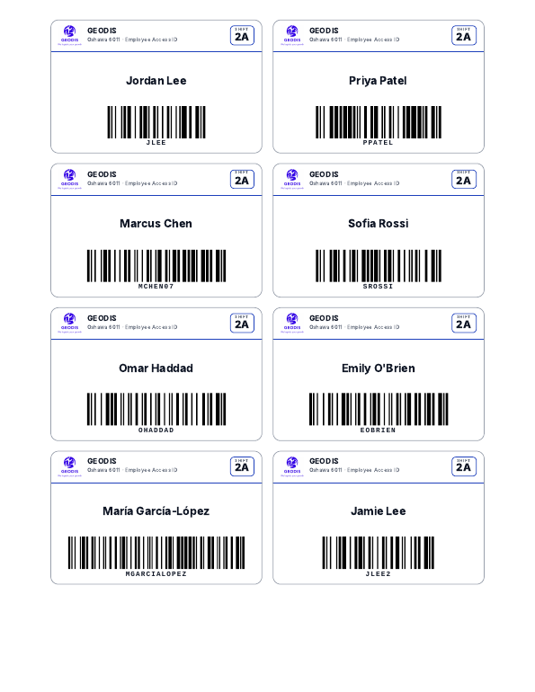
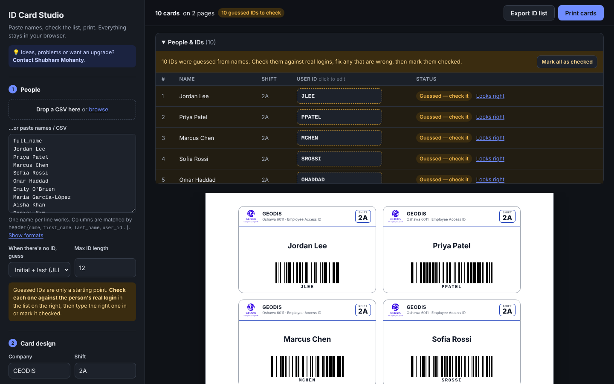

# Printable ID Cards

A browser-only generator for credit-card-size (85.6 × 54 mm) ID cards with Code 128 barcodes.
No server, no install, no internet needed — open `index.html` and go, or use the live page:
**https://sm-7603.github.io/printable-id-card-generator/**

## Use it

1. **People** — drop a CSV on the page, or paste names (straight from Excel/Sheets works too).
2. **Check the IDs** — the *People & IDs* list shows every ID and where it came from:
   - **Checked** (green): the ID came from your list.
   - **Guessed — check it** (amber, dashed box): there was no ID, so one was made from the name.
     Click the box to type the real login, or press *Looks right* / *Mark all as checked*.
     Either way the ID is written into your list, so it counts as checked from then on.
   - Red rows (no name, no ID, the same ID twice) are left off the printout until fixed.

   *Print cards* asks before printing any guessed ID that hasn't been checked.

   

3. **Card design** — company, shift, site, card label, accent colour, logo. The header is white by
   default to save ink; tick *Coloured header* for a filled band.

   | White header (default, less ink) | Coloured header |
   | --- | --- |
   |  |  |

4. **Print** — in the print dialog use **100% / Actual size**, margins **None**,
   headers & footers **off**, background graphics **on**. Cards per page are worked out from
   the paper, orientation, margin and gap (8 on Letter portrait).

   

*Export ID list* downloads `full_name,user_id,shift,id_source` for everyone, so you have a record of what was printed.
Settings and the name list are saved in your browser between visits; *Reset everything* clears them.

**Theme:** Light, Dark or System (follows your computer) at the bottom of the sidebar. Only the app changes; the card preview stays white because that's what prints.

## Getting the right IDs

Guessing from names is the weak spot: logins often don't follow the pattern (duplicates, nicknames, old accounts).
Best to worst:

1. **Export the list from the system the badges are for** (the WMS user list, or an AD export) with name and login
   columns, and drop that CSV in. Nothing is guessed.
2. **Ask a lead or supervisor to fill in the template** (*Download template CSV*: `full_name,user_id,shift`).
   Blank `user_id` cells are fine; those rows are guessed and flagged.
3. **Paste names only** and check every amber row against the real login before printing.

## Input formats

Columns are matched by header (case and punctuation don't matter). Recognised headers:

| Field | Headers |
| --- | --- |
| Full name | `full_name`, `name`, `employee name`, `employee`, `associate` |
| First / last | `first_name`, `first`, `given name` / `last_name`, `last`, `surname`, `family name` |
| User ID | `user_id`, `id`, `employee id`, `badge`, `badge id`, `login`, `username` |
| Shift | `shift`, `team`, `crew` (overrides the Shift field for that person) |

Comma, semicolon and tab separators all work; quoted fields and Excel's UTF-8 BOM are handled.
Without a header the app guesses: one column = full name; `Full Name,ID`; `ID,Full Name`; `First,Last`; `First,Last,ID`.

## ID rules

- When a row has no ID, one is guessed with the rule you pick: **initial + last** (`JLEE`, default),
  **first name** (`JORDAN`), **first + initial** (`JORDANL`) or **first + last** (`JORDANLEE`).
  Accents are removed, only letters/digits are kept, the result is uppercased and cut to *Max ID length* (default 12).
- If a guessed ID is already taken, a number is added (`JLEE`, `JLEE2`…) while staying within the max length.
- IDs supplied in your data are used as-is (cleaned of spaces/symbols). Duplicates among them are flagged, not silently changed.

## Files

- `index.html` — layout
- `styles.css` — app and card styling, print rules
- `app.js` — parsing, ID generation, rendering, persistence
- `barcode.js` — self-contained Code 128 encoder (SVG)
- `assets/` — default logo
- `docs/screenshots/` — images used in this README

When you change `styles.css`, `app.js` or `barcode.js`, bump the `?v=` number on their links in `index.html`.
Otherwise browsers (Firefox especially) keep using the old copies for a while after GitHub Pages updates.
